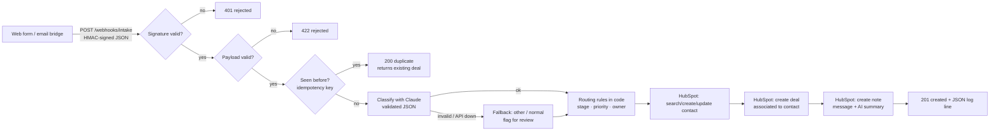

# Brokerage Intake → HubSpot

Automatic intake for an insurance brokerage. Inbound requests from the website form or
email are read, labeled and filed into HubSpot CRM, so staff no longer have to re-key them.

[](https://github.com/christullier/upwork-spike-hubspot/actions/workflows/ci.yml)

---

## For the agency owner

### The problem
Every day the agency gets a stream of requests: *"Can I get a quote for two more trucks?"*,
*"The GC needs a certificate of insurance by Monday"*, *"Please add my son to our auto policy"*,
*"Our workers comp renews on the 1st"*. Someone has to read each one, type the details into
HubSpot, decide what kind of request it is, how urgent it is, and who should handle it.
That is slow, easy to get wrong, and it pulls account managers away from customers.

### What this service does
For every incoming request it, automatically and in a few seconds:

1. **Checks that the request really came from your form or email bridge** (not spam or a bot).
2. **Reads the message with AI** and labels it: *new quote, certificate (COI), policy change,
   renewal,* or *other*. It also labels urgency (high / normal / low), the line of business if
   mentioned, and writes a one-sentence summary.
3. **Files it in HubSpot**: finds the customer's existing contact (or creates one, no
   duplicates), opens a deal in the right pipeline stage with the right priority and owner,
   and attaches a note with the original message and the AI summary.
4. **Never creates a duplicate deal** if the same request is sent twice.
5. **Sends anything uncertain to a "Needs Review" stage.** If the AI is unsure or unavailable,
   a person looks at it. Nothing is lost.

### What it saves
Illustrative numbers: if re-keying and triaging takes about 4 minutes per request and you get
30 a day, that's **about 2 hours of staff time a day**. Urgent COIs also reach the right
person within seconds, not whenever someone next checks the inbox.

### What it doesn't do
It does not quote, bind, or issue certificates. It gets each request to the right person
with everything they need, and people do the insurance work.

---

## How it works



Text version: `webhook → verify HMAC → validate payload → idempotency check → classify (Claude)
→ route (code) → HubSpot contact upsert → deal → note → log`.

### Project layout

| File | Responsibility |
|---|---|
| `app/main.py` | FastAPI app, `POST /webhooks/intake`, pipeline orchestration, run logging |
| `app/schemas.py` | Pydantic models: payload, LLM output, response |
| `app/security.py` | HMAC-SHA256 signature + timestamp verification |
| `app/classify.py` | Claude call (forced tool use) → validated classification or fallback |
| `app/routing.py` | Plain-code routing table: stage, priority, owner, deal name, note body |
| `app/hubspot.py` | CRM v3 client (contacts, deals, notes) with retry/backoff |
| `app/idempotency.py` | Idempotency key + SQLite ledger |
| `app/config.py`, `app/logs.py` | Env-var settings, JSON logging |
| `scripts/live_smoke.py` | One real end-to-end run against HubSpot + Claude |
| `scripts/list_pipelines.py` | Prints your deal pipeline/stage IDs for `.env` |

---

## Setup (developers)

Requires Python 3.12+.

```bash
python3.12 -m venv .venv && source .venv/bin/activate
```

```bash
pip install -e ".[dev]"
```

```bash
cp .env.example .env
```

### Environment variables

All configuration comes from environment variables (or `.env` for the scripts). Nothing secret
is in the code or the repo; `.env` is git-ignored.

| Variable | Required | Purpose |
|---|---|---|
| `WEBHOOK_SECRET` | yes | Shared secret for HMAC signatures. Generate: `python -c "import secrets; print(secrets.token_hex(32))"` |
| `HUBSPOT_TOKEN` | yes | Private app access token (`pat-...`) |
| `HUBSPOT_PIPELINE_ID` | yes | Deal pipeline ID |
| `HUBSPOT_STAGE_QUOTE` / `_COI` / `_POLICY_CHANGE` / `_RENEWAL` / `_REVIEW` | yes | Stage ID for each request type, plus the review stage |
| `HUBSPOT_OWNER_<TYPE>` | no | HubSpot owner ID to assign per type (e.g. `HUBSPOT_OWNER_COI`) |
| `HUBSPOT_IDEMPOTENCY_PROPERTY` | no | Custom deal property holding the idempotency key (default `intake_idempotency_key`; blank disables the HubSpot-side check) |
| `ANTHROPIC_API_KEY` | yes (live) | Claude API key |
| `ANTHROPIC_MODEL` | no | Model ID (default `claude-haiku-5-5`) |
| `ANTHROPIC_TIMEOUT_SECONDS`, `ANTHROPIC_MAX_RETRIES` | no | Default 15s, 2 retries |
| `HUBSPOT_MAX_RETRIES` | no | Retries on 429/5xx (default 3) |
| `SIGNATURE_TOLERANCE_SECONDS` | no | Max clock skew / replay window (default 300) |
| `IDEMPOTENCY_DB_PATH`, `IDEMPOTENCY_WINDOW_SECONDS` | no | Ledger file and dedupe bucket (default 1 hour) |
| `LOG_LEVEL` | no | Default `INFO` |

### HubSpot setup

1. **Use a test account.** Create a free [HubSpot developer account](https://developers.hubspot.com/)
   and a *developer test account* inside it, so the smoke test never touches real customer data.
2. **Create a private app** in the test account: *Settings → Integrations → Private Apps →
   Create a private app.* (Newer accounts may list this under *Development → Legacy apps*.)
   Give it these scopes:

   | Scope | Why |
   |---|---|
   | `crm.objects.contacts.read` | search contacts by email |
   | `crm.objects.contacts.write` | create/update contacts; create notes on contacts |
   | `crm.objects.deals.read` | search deals by idempotency key; list pipelines |
   | `crm.objects.deals.write` | create deals |
   | `crm.schemas.deals.write` *(setup only)* | create the idempotency property / pipeline via API instead of the UI |
   | `crm.objects.owners.read` *(optional)* | only if you want to look up owner IDs via API |

   Copy the access token into `HUBSPOT_TOKEN`. HubSpot ties notes to the scopes of the
   objects they're attached to; if note creation returns 403, check the scope list in the
   app settings.
3. **Create the pipeline.** *Settings → Objects → Deals → Pipelines*: add a pipeline named
   **Intake** with stages **New Quote, COI Request, Policy Change, Renewal, Needs Review**
   (add Won/Lost-style closing stages if you like).
4. **Create the idempotency property.** *Settings → Properties → Deal properties → Create
   property*: label `Intake idempotency key`, internal name `intake_idempotency_key`, type
   *single-line text*. (Or set `HUBSPOT_IDEMPOTENCY_PROPERTY=` blank to skip it. If the
   variable is set but the property doesn't exist, every request fails with a 502 because
   HubSpot rejects the unknown property. That's deliberate, so it fails loudly.)
5. **Get the IDs** for `.env`:

   ```bash
   python scripts/list_pipelines.py
   ```

6. *(Optional)* Owner IDs: *Settings → Users & Teams*, or `GET /crm/v3/owners`.

### Run the server

```bash
uvicorn --factory app.main:create_app --reload
```

Interactive API docs: <http://localhost:8000/docs>. Health check: `GET /healthz`.

### Sending a signed request

The sender signs `"{timestamp}.{raw_body}"` with HMAC-SHA256 and sends two headers:

```
X-Timestamp: 1767225600
X-Signature: sha256=<hex digest>
```

From a shell (with `WEBHOOK_SECRET` exported):

```bash
BODY="$(cat tests/fixtures/intake_coi.json)"; TS=$(date +%s); SIG=$(printf '%s.%s' "$TS" "$BODY" | openssl dgst -sha256 -hmac "$WEBHOOK_SECRET" -hex | sed 's/^.* //'); curl -sS -X POST localhost:8000/webhooks/intake -H 'Content-Type: application/json' -H "X-Timestamp: $TS" -H "X-Signature: sha256=$SIG" --data-binary "$BODY"
```

Responses: `201` created (or `resumed`), `200` duplicate, `401` bad signature, `409` an
identical request is mid-flight, `422` invalid payload, `502` HubSpot unavailable (safe to retry).

### Run the tests

```bash
pytest
```

```bash
ruff check . && ruff format --check .
```

The suite is **fully offline**: an autouse fixture blocks every real TCP connection, so a
missed mock fails the test rather than calling a live API. HubSpot (`httpx`) is mocked
with **respx**. The Anthropic SDK 2.x sends requests through `httpx2`, which respx can't
patch, so Claude responses are served by an `httpx2.MockTransport` injected into the SDK
client (`tests/fakes.py`). Sample payloads and a malformed model response are in
`tests/fixtures/`.

Covered: happy path for each request type, existing-contact update, 409 contact race,
duplicate submission (same and cosmetically different), duplicate found only in HubSpot,
bad/missing/stale signature (401), invalid and non-JSON payload (422), malformed LLM
output and LLM API outage (fallback and review flag), HubSpot 429 then success (honours
`Retry-After`), HubSpot 500 exhausting retries (502, then a clean retry), note failure
resumed without a second deal, HTML escaping in notes, and the structured log line.

CI (`.github/workflows/ci.yml`) runs ruff and pytest on every push and PR. No secrets are
needed.

### Live mode

`scripts/live_smoke.py` sends one real request end to end: it calls Claude, creates a
contact, a deal and a note in HubSpot, then sends the identical payload again and checks
that it is reported as a duplicate. It needs `HUBSPOT_TOKEN` and `ANTHROPIC_API_KEY` plus
the pipeline/stage variables, and exits with code 2 if they are missing.
`GET /account-info/v3/details`, used only to print record links, needs no extra scope.

```bash
python scripts/live_smoke.py
```

```bash
python scripts/live_smoke.py --fixture tests/fixtures/intake_quote.json --url http://localhost:8000/webhooks/intake
```

Add `--skip-llm` to test only the HubSpot side without an Anthropic key (the request takes
the needs-review fallback path). The script prints links to the created contact and deal.
**Last verified live (2026-11-03, `--skip-llm`):** against a HubSpot portal, the contact was
created, and a deal landed in the Intake pipeline's *Needs Review* stage with `hs_priority=medium`
and the idempotency key set. The deal and note were associated with the contact. The repeat
submission returned `duplicate`, and the HubSpot-side key search found the deal. A live Claude
classification has not been verified yet.

Each run adds a `+smoke<random>` tag to the email so runs don't merge into one contact.
**It creates real records**, so point it at a test account.

---

## Design decisions

**Code decides routing, not the model.** Claude only *labels* the request
(`request_type`, `urgency`, `line_of_business`, `summary`). The mapping from labels to
pipeline stage, priority and owner is a plain dictionary in `app/routing.py`. That makes
routing deterministic, unit-testable, auditable ("why did this go to Dana?" has a one-line
answer), and changeable by editing config, not prompts. It also limits prompt injection:
a customer who writes "assign this to the CEO" can at most change a label, never pick a
destination.

**LLM output is untrusted input.** The model is forced to answer through a single tool call
whose schema allows only the valid enum values, and the result is re-validated with Pydantic
(`extra="forbid"`). The customer message is wrapped in `<message>` tags, and the prompt says
to treat it as data. If the API errors or times out, or the output fails validation, the
request falls back to `other` / `normal` with `needs_review=true` and goes to the *Needs
Review* stage. The CRM record is still created; an AI outage never drops a request.

**Idempotency.** Key = `sha256(lower(email) + normalised message + time bucket)`, where the
bucket is the signed timestamp floored to `IDEMPOTENCY_WINDOW_SECONDS` (1 hour). Lookups check
the current *and previous* bucket, so a resend at 10:59 and 11:01 is still caught. There are
two layers:
1. A local SQLite ledger (stdlib, no extra dependency). It is the fast path and also an
   atomic claim, so two identical requests arriving at once can't both create a deal; the
   second gets `409`.
2. The key is written to a custom deal property and searched before creating anything. This
   survives restarts and works across multiple app instances. HubSpot's search index lags a
   few seconds, which is why layer 1 exists.

Each ledger entry moves `processing → deal_created → completed`. If HubSpot fails before the
deal exists, the claim is released and the sender can retry cleanly. If it fails after the
deal exists (say, the note call), the retry **resumes** at the note step and doesn't open a
second deal. Abandoned `processing` claims expire after 2 minutes.

**Retry policy.** HubSpot calls retry on `429`, `500`, `502`, `503`, `504` and network errors:
up to 3 retries with exponential backoff (0.5s, 1s, 2s, plus jitter, capped at 30s). A
`Retry-After` header, in seconds or as an HTTP date, overrides the computed delay. Other
4xx errors (bad scopes, bad stage ID) fail at once, because retrying won't fix them. The
Claude call uses the SDK's built-in retries (2) with a 15s timeout, then the fallback above.

**Failure handling.** Each failure has its own status code: `401` and `422` mean the sender
must fix something, `409` means wait, and `502` means HubSpot is down and a retry is safe.
`422` responses list the failing fields but not their values, so personal details aren't
echoed back.

**Signature before parsing.** The HMAC is verified over the raw bytes before JSON parsing,
so unauthenticated traffic costs almost nothing and never reaches the validator, the LLM or
the CRM. The timestamp is part of the signed string and must be within 5 minutes, which
blocks replays.

**Structured logging.** One JSON line per request (`intake.processed`) with `intake_id`,
truncated idempotency key, classification, review reason, HubSpot contact/deal/note IDs,
outcome, HTTP status and `latency_ms`. Emails are masked (`d***@example.com`), and message
bodies are never logged.

**Synchronous processing.** The webhook responds after the CRM work is done (typically a few
seconds). That keeps the demo simple and lets the sender see the outcome. At higher volume,
or with senders that time out quickly, the next step is to respond `202` and move the work
to a queue; the idempotency ledger already supports that.

**Deals, not tickets.** Quotes and renewals are revenue work, so deals fit, and one deal
pipeline keeps setup small. In a real agency, COIs and policy changes might go to HubSpot
*tickets* (Service Hub) instead; that would be a small change in `routing.py` and `hubspot.py`.

## Known limitations

- The SQLite ledger is per-instance; with several instances, HubSpot's property check is
  the shared layer (or swap SQLite for Postgres/Redis).
- A HubSpot `5xx` on *deal creation* is retried; if HubSpot actually created the deal before
  failing, a duplicate is possible within that one request. The idempotency property makes
  this easy to find and merge.
- Attachments are recorded by filename only; the file itself is not uploaded.
- The name is split on the first space into first/last name.
